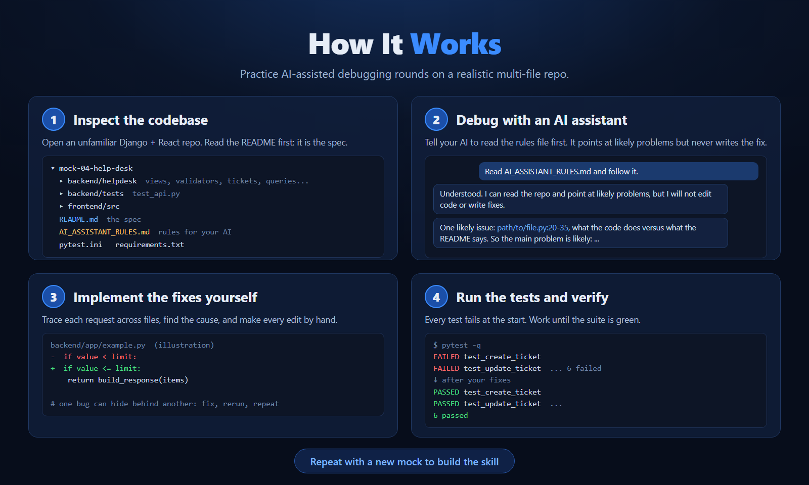
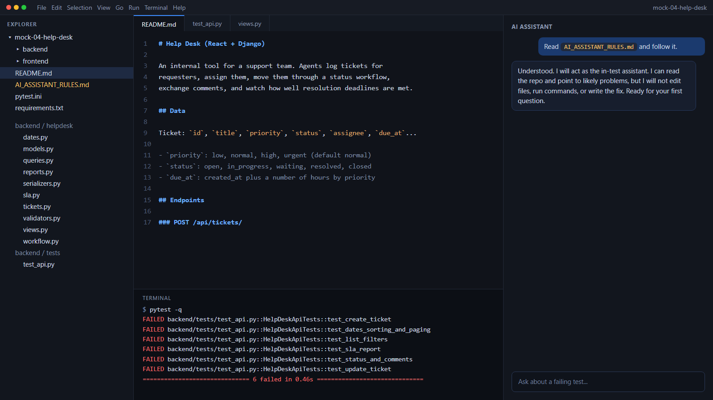

<p align="center">
  
  
</p>

# AI-Assisted OA Practice

Practice mocks for **AI-assisted coding online assessments** (also called AI-assisted repository debugging tasks). In this format you get an unfamiliar full-stack repo with failing tests and an AI assistant in the editor. You have about 60 minutes to find the bugs and make the tests pass.

This kind of round is reported by candidates for software engineering internship and new-grad roles at large tech companies such as Amazon and Microsoft. These mocks are original practice material inspired by the general format. They are not affiliated with or endorsed by any company, and they contain no real assessment content.

Each mock is a small app in one stack (Django, Node.js or C++). The bugs are in the backend or core code, never in the frontend. Every test fails when you start.

## Mocks

| Mock | Domain | Tests | Stack | Download |
|---|---|---|---|---|
| [mock-01-returns-desk](mock-01-returns-desk) | Returns desk: returns, items, status workflow | 6 | Django | [zip](https://github.com/Anirudhpahwa/ai-assisted-oa-practice/releases/latest/download/mock-01-returns-desk.zip) |
| [mock-02-leave-desk](mock-02-leave-desk) | Leave desk: time-off requests, balances, approvals | 6 | Django | [zip](https://github.com/Anirudhpahwa/ai-assisted-oa-practice/releases/latest/download/mock-02-leave-desk.zip) |
| [mock-03-stock-count-desk](mock-03-stock-count-desk) | Stock count desk: cycle count sessions, counted lines, approval, shortage report | 6 | Django | [zip](https://github.com/Anirudhpahwa/ai-assisted-oa-practice/releases/latest/download/mock-03-stock-count-desk.zip) |
| [mock-04-help-desk](mock-04-help-desk) | Help desk: support tickets, SLA deadlines, comments, history | 6 | Django | [zip](https://github.com/Anirudhpahwa/ai-assisted-oa-practice/releases/latest/download/mock-04-help-desk.zip) |
| [mock-05-equipment-loan-desk](mock-05-equipment-loan-desk) | Equipment loan desk: loans, availability, late fees, extensions, borrower summary | 6 | Django | [zip](https://github.com/Anirudhpahwa/ai-assisted-oa-practice/releases/latest/download/mock-05-equipment-loan-desk.zip) |
| [mock-06-shift-roster-desk](mock-06-shift-roster-desk) | Shift roster desk: shift requests, rest and weekly limits, overtime pay, summary | 6 | C++ | [zip](https://github.com/Anirudhpahwa/ai-assisted-oa-practice/releases/latest/download/mock-06-shift-roster-desk.zip) |
| [mock-07-event-signup-desk](mock-07-event-signup-desk) | Event sign-up desk: events, registrations with guests, waitlist promotion, organizer summary | 6 | Node.js | [zip](https://github.com/Anirudhpahwa/ai-assisted-oa-practice/releases/latest/download/mock-07-event-signup-desk.zip) |

Solutions live in a separate repo so they don't show up while you practice: [ai-assisted-oa-practice-solutions](https://github.com/Anirudhpahwa/ai-assisted-oa-practice-solutions). Open them only after you finish.

## How to practice

1. **Get one mock.** Click its **zip** link in the table above and unzip it. (Or use Code, then Download ZIP for the whole repo and take one folder.)
2. **Open that mock's folder in VS Code** (File, then Open Folder). Open the mock folder itself, not the repo root.
3. **Install and run the tests** from inside that mock folder, using the steps for its stack in [Set up by stack](#set-up-by-stack) below. All tests should fail at first.
4. **Start a 60-minute timer.** Read the mock's `README.md` first, then the tests.
5. **Use an AI assistant in your editor** (Claude Code, Copilot Chat, Cursor, Codex, Gemini or similar) with the mock folder open. **Your first message to it must be: "Read AI_ASSISTANT_RULES.md and follow it."** That file makes the assistant act as a read-only assessment helper that points you at likely problems but never edits your code. Do this before asking anything else.
6. **Make every edit yourself.** If the mock has a `frontend/` folder, don't run it. It is there for reference only.
7. When the timer ends or all tests pass, check your fixes against the solutions repo.

About 10 minutes per test is a good pace for a 6-test mock.

## Set up by stack

Run these from inside the mock folder. Each mock's own `README.md` also has a "Running the tests" section.

<details>
<summary><b>Django</b> (mocks 1 to 5): needs Python 3.10 or newer</summary>

```
python -m venv venv
venv\Scripts\activate        # macOS/Linux: source venv/bin/activate
pip install -r requirements.txt
pytest
```

On Windows PowerShell, if activation is blocked, run `Set-ExecutionPolicy -Scope Process -ExecutionPolicy Bypass` first, or skip activation and use `venv\Scripts\python -m pytest`.
</details>

<details>
<summary><b>Node.js</b> (mock 7): needs Node.js 18 or newer</summary>

```
npm install
npm test
```

No venv is needed; packages go into `node_modules` in the mock folder. The first `npm test` downloads a MongoDB binary (about 100 MB) for the in-memory test database, so you need an internet connection and a minute. You do not need to install or run MongoDB yourself. Do not run `npm start`.

To run one test: `npx jest -t "create event"` (use any test name).
</details>

<details>
<summary><b>C++</b> (mock 6): needs <code>g++</code> with C++17 support on your PATH</summary>

```
test.bat        (Windows)
./test.sh       (macOS / Linux)
```

The script builds and runs the tests. There is also `run.bat` / `run.sh`, which runs the program on the sample files in `data/sample`.
</details>

## Contributing

Found a mock where a test is unfair, or the README doesn't define a tested behavior? Open an issue.

## License

[MIT](LICENSE)
